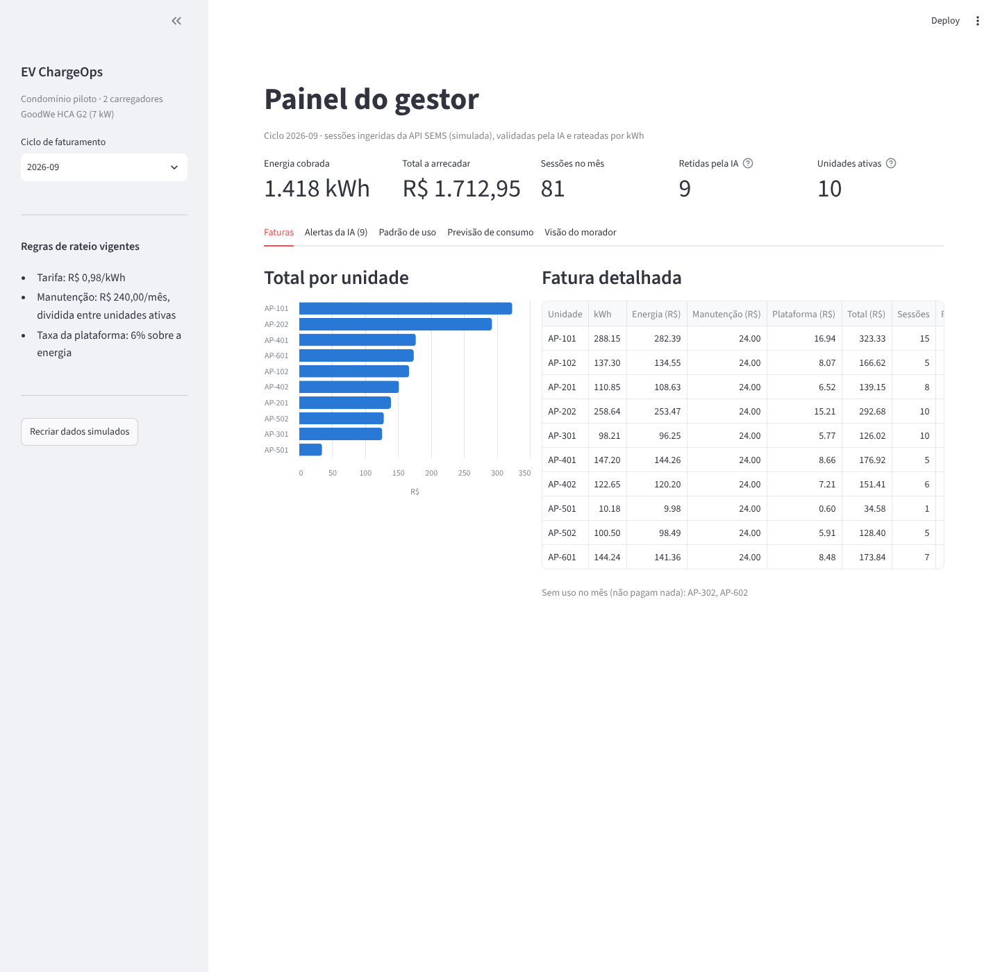
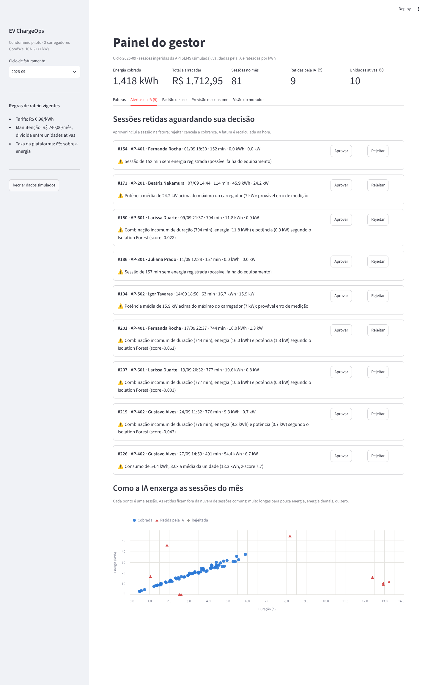
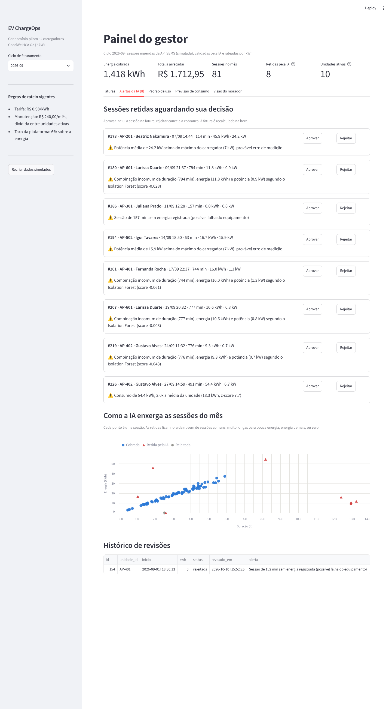
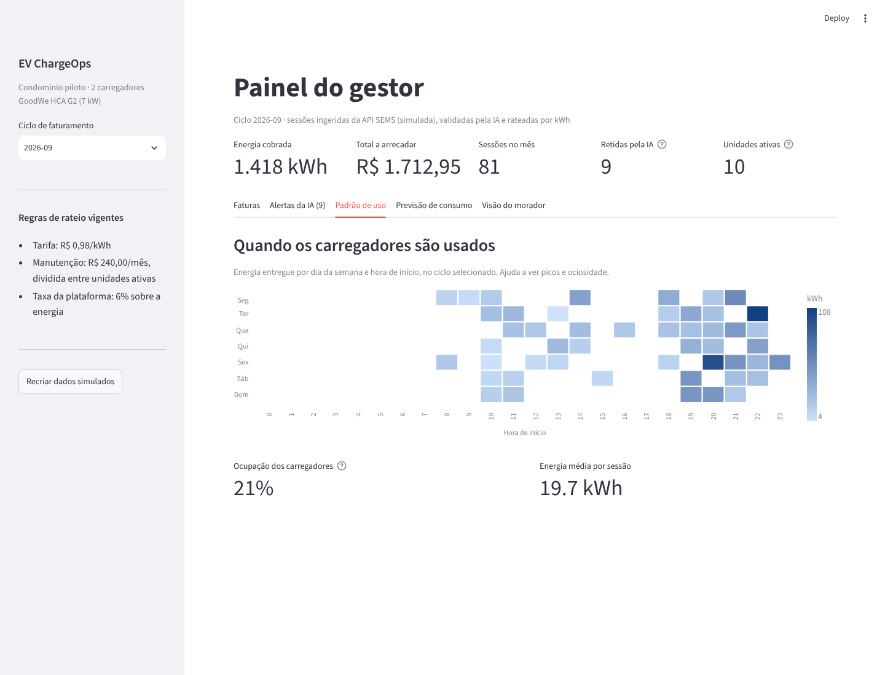
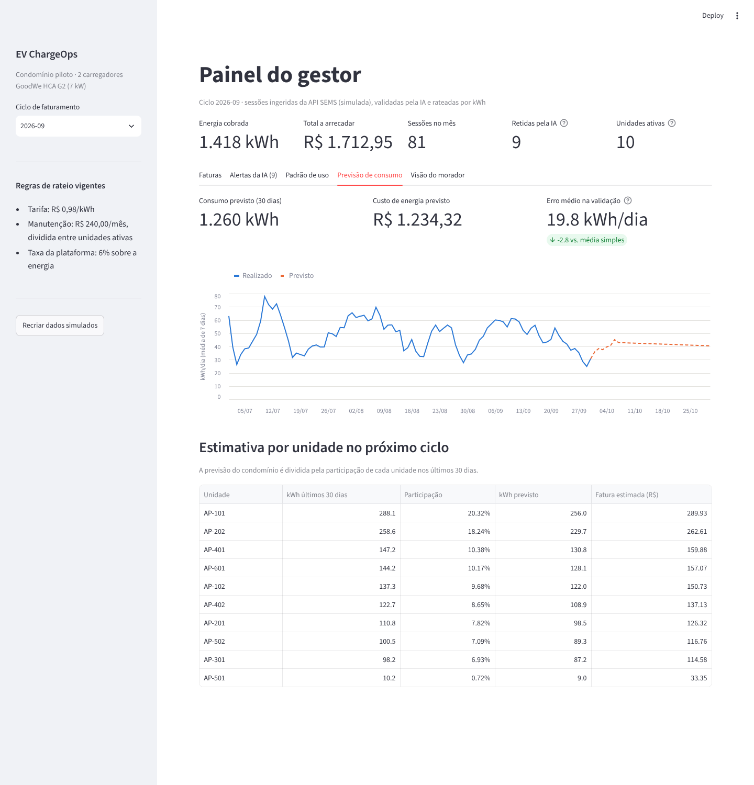
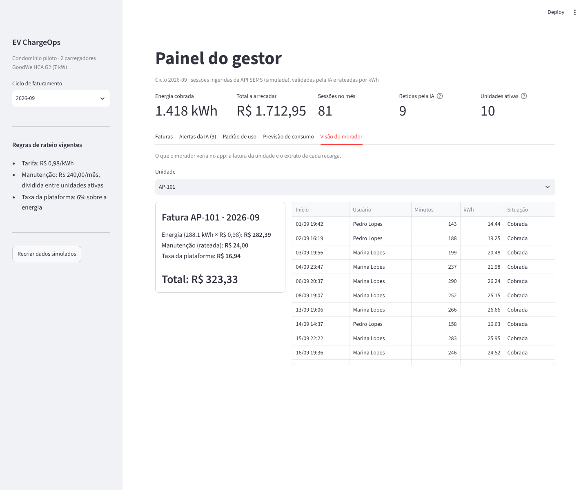

# EV ChargeOps — Sprint 2: Desenvolvimento e Prototipação

**Equipe:** Cereto Tech1
**Integrante:** Denis Urbano Cereto — RM 569187

**Desafio:** Enterprise Challenge 2026 — GoodWe / FIAP
**Sprint 1 (pesquisa e arquitetura):** https://github.com/deniscereto/Challenge-GoodWe-ev-chargeops-sprint1

---

## 1. O que foi implementado

Protótipo funcional do EV ChargeOps, seguindo a arquitetura da Sprint 1 (seção 4.1) e o fluxo de dados da seção 4.2:

```
 Carregador HCA G2 ──► API SEMS (simulada) ──► Ingestão ──► IA de anomalias ──► Rateio ──► Faturas
   (simulador.py)        (sems_client.py)     (ingestao.py)   (anomalias.py)    (rateio.py)
                                                                   │
                                                 sessão suspeita ──┴──► gestor aprova/rejeita
                                                                                   │
                                         Dashboard do gestor (dashboard.py) ◄──────┤
                                         API REST p/ app do morador (api.py) ◄─────┘
                                         Previsão de consumo (previsao.py)
```

| Requisito da Sprint 2 | Onde está |
|---|---|
| Registrar sessões de recarga | `chargeops/ingestao.py`: busca no SEMS, normaliza e grava no banco, sem duplicar |
| Calcular consumo individual | Sessão vinculada a usuário e unidade pelo cartão RFID; kWh somado por unidade |
| Aplicar o modelo de rateio | `chargeops/rateio.py`: kWh × tarifa + manutenção só entre unidades ativas + taxa da plataforma |
| Módulo de IA estrutural | `chargeops/anomalias.py`: toda sessão passa pela IA **antes** de ser cobrada |
| Segunda frente de IA | `chargeops/previsao.py`: previsão de consumo para os próximos 30 dias |
| Evidências | `docs/evidencias/`: prints do dashboard, saídas executadas, avaliação da IA e testes |

---

## 2. Como executar

Requisitos: Python 3.10 ou superior.

```bash
# 1. Criar e ativar um ambiente virtual
python -m venv .venv
.venv\Scripts\activate          # Windows
source .venv/bin/activate       # macOS / Linux

# 2. Instalar as dependências
pip install -r requirements.txt

# 3. Rodar o fluxo completo pelo terminal (gera dados, IA, faturas e previsão)
python executar_pipeline.py

# 4. Abrir o dashboard do gestor (abre no navegador)
streamlit run dashboard.py

# 5. (Opcional) Subir a API REST — documentação em http://127.0.0.1:8000/docs
uvicorn api:app --reload

# 6. Testes automatizados e avaliação da IA
python -m pytest -v
python avaliar_ia.py
```

O dashboard funciona sozinho: se o banco não existir, ele roda o passo 3 automaticamente na primeira abertura.

---

## 3. Estrutura do repositório

```
├── chargeops/                  # núcleo da solução (camada de aplicação)
│   ├── config.py               # parâmetros de negócio: tarifa, manutenção, limiares da IA
│   ├── database.py             # esquema SQLite: unidades, usuários, carregadores, sessões, faturas
│   ├── simulador.py            # condomínio fictício + gerador de sessões do HCA G2 (mock SEMS)
│   ├── sems_client.py          # cliente mock da API SEMS + esqueleto do cliente real
│   ├── ingestao.py             # Session Service: normaliza o JSON do SEMS e grava as sessões
│   ├── anomalias.py            # AI Engine: regras físicas + z-score + Isolation Forest
│   ├── rateio.py               # Rateio Engine + Billing: faturas por unidade
│   ├── previsao.py             # AI Engine: previsão de consumo (regressão)
│   └── pipeline.py             # orquestra ingestão → IA → rateio
├── executar_pipeline.py        # roda tudo pelo terminal e imprime o resultado
├── avaliar_ia.py               # mede acertos da IA em 10 cenários simulados
├── dashboard.py                # dashboard do gestor (Streamlit)
├── api.py                      # API REST (FastAPI)
├── tests/                      # testes automatizados (pytest)
└── docs/
    ├── exemplo_resposta_sems.json   # formato da resposta simulada da API SEMS
    └── evidencias/                  # prints e saídas executadas
```

---

## 4. Lógica central

### 4.1 Registro da sessão

O simulador gera, para cada dia, um JSON no formato que esperamos da API SEMS (ver `docs/exemplo_resposta_sems.json`): duração em segundos, potência em W, data em texto e o número do cartão RFID. A ingestão converte isso para o esquema interno:

- segundos → minutos, W → kW, texto → data ISO;
- **cartão RFID → usuário → unidade** (é o que permite cobrar cada apartamento);
- a potência média é **calculada por nós** (kWh ÷ horas), em vez de confiarmos no valor do equipamento, porque é justamente ela que denuncia erros de medição;
- o `orderId` do SEMS é único no banco, então rodar a ingestão duas vezes não duplica sessões.

Toda sessão nova entra com status `pendente`.

### 4.2 Rateio (Sprint 1, seção 4.3)

```
fatura_unidade = Σ (kwh_sessao × tarifa)                       [sessões cobráveis da unidade no mês]
               + custo_manutencao ÷ nº de unidades ativas      [só se a unidade usou no mês]
               + taxa da plataforma (6% sobre a energia)       [linha separada na fatura, seção 4.6]
```

Parâmetros em `chargeops/config.py`: tarifa de R$ 0,98/kWh (valor de exemplo, a ser trocado pela tarifa real), manutenção de R$ 240,00/mês e taxa da plataforma de 6%.

Exemplo real da execução (ciclo 2026-09, unidade AP-101, dois carros):
`288,15 kWh × R$ 0,98 = R$ 282,39` + `R$ 240 ÷ 10 unidades ativas = R$ 24,00` + `6% = R$ 16,94` → **R$ 323,33**.

| Caso excepcional (Sprint 1) | Como foi implementado | Teste |
|---|---|---|
| Sessão interrompida | Cobra só o kWh medido até a interrupção | `test_sessao_interrompida_cobra_so_o_que_foi_entregue` |
| Unidade sem sessão no mês | Não gera fatura e não entra na divisão da manutenção | `test_unidade_sem_sessao_nao_paga_nada` |
| Dois carros na mesma unidade | Sessões somadas por `unidade_id`, fatura única | `test_dois_carros_mesma_unidade_somam_numa_fatura` |
| Sessão suspeita | Fica `em_revisao`, fora da cobrança até o gestor decidir | `test_sessao_em_revisao_fica_fora_da_cobranca` |
| kWh zero em sessão longa | Retida pela regra física da IA | `test_regra_sessao_longa_sem_energia` |

Ciclo de vida da sessão:

```
pendente ──IA──► valida ─────────────────────► cobrada na fatura
            └──► em_revisao ──gestor aprova──► aprovada ──► cobrada (fatura recalculada)
                            └─gestor rejeita─► rejeitada ─► nunca cobrada
```

---

## 5. Módulo de IA

### 5.1 Por que ele é estrutural

A IA fica **entre a ingestão e o rateio**, como definido na Sprint 1 (seção 4.2). O Rateio Engine se recusa a calcular a fatura enquanto existir sessão `pendente` no mês (`rateio.calcular_ciclo` lança erro, coberto pelo teste `test_rateio_bloqueado_se_ia_nao_rodou`). Sem a IA, ninguém é cobrado; com ela, nenhuma sessão suspeita chega à fatura do morador sem passar pelo gestor.

### 5.2 As três camadas da detecção de anomalias

| Camada | Técnica | O que pega | Por que existe |
|---|---|---|---|
| 1. Regras físicas | Verificações determinísticas | kWh zero em sessão longa, potência acima do limite do carregador, cartão não cadastrado | São impossibilidades: não precisam de modelo, e explicar "potência de 24 kW num carregador de 7 kW" é imediato para o gestor |
| 2. Z-score por unidade | Estatística | Consumo muito acima do histórico **da própria unidade** (z > 3) | 50 kWh pode ser normal para um apartamento e absurdo para outro |
| 3. Isolation Forest | Modelo não supervisionado (scikit-learn), olhando duração, energia e potência juntas | Combinações raras, como 12 horas plugado a 0,8 kW | Cada número isolado parece normal; só a combinação é estranha |

Cada sessão retida recebe um texto explicando o motivo (ex.: *"Consumo de 54,4 kWh, 3,0x a média da unidade (18,3 kWh, z-score 7,7)"*), mostrado ao gestor no dashboard. O Isolation Forest é treinado só com sessões que passaram nas regras físicas, para não aprender "lixo de medição" como se fosse normal.

### 5.3 A IA funciona? (`python avaliar_ia.py`)

O simulador injeta cinco tipos de problema em cerca de 5% das sessões e guarda um gabarito, usado **apenas** para medir o desempenho. Resultado em 10 cenários diferentes (2.275 sessões, 120 anomalias injetadas):

| Métrica | Resultado |
|---|---|
| Recall (anomalias retidas) | **98%** (118 de 120) |
| Precisão (retidas que eram mesmo anomalias) | **86%** |
| Sessões normais retidas à toa | **0,9%** |

| Tipo de anomalia | Detectadas | Camada que pegou |
|---|---|---|
| Sessão sem energia | 31/31 | Regras físicas |
| Medição impossível | 24/24 | Regras físicas |
| Cartão não cadastrado | 6/6 | Regras físicas |
| Consumo atípico (~3x o normal) | 27/29 | Z-score (25) e Isolation Forest (23) |
| Potência muito baixa por horas | 30/30 | **Só o Isolation Forest** |

A última linha justifica o modelo de ML: nenhuma regra simples nem o z-score de kWh encontrou essas sessões.

**Limitação observada:** o Isolation Forest usa uma "contaminação" fixa de 3%, então em meses com poucas anomalias reais ele retém algumas sessões normais (cenário 10: 4 anomalias e 5 falsos positivos). Como a sessão é só retida, e não cancelada, o custo do erro é uma revisão a mais para o gestor, não uma cobrança errada. Ajustar esse parâmetro com dados reais é um próximo passo.

### 5.4 Previsão de consumo

Regressão linear (scikit-learn) sobre o consumo diário do condomínio, usando tendência e fim de semana. Projeta os próximos 30 dias e divide entre as unidades pela participação de cada uma nos últimos 30 dias, gerando uma **fatura estimada** por unidade.

O modelo é validado nos últimos 14 dias do histórico, que ele não viu no treino, e comparado com um método ingênuo (repetir a média dos últimos 28 dias). Na execução padrão, o erro foi de **19,8 kWh/dia contra 22,6 kWh/dia** do método ingênuo. Em 10 cenários a vantagem foi pequena (22,3 contra 23,2 kWh/dia), e testamos variáveis extras (uma coluna por dia da semana, número de usuários ativos) sem ganho. Com apenas três meses de dados e poucas sessões por dia, o consumo diário é muito aleatório; o valor do modelo está mais no total do mês do que no dia a dia. Por isso ficamos com o modelo mais simples e deixamos o resultado da comparação visível no dashboard.

---

## 6. Evidências de funcionamento

Todas em `docs/evidencias/`:

| Arquivo | O que mostra |
|---|---|
| `saida_pipeline.txt` | Execução completa: ingestão, 17 sessões retidas com o motivo, faturas de julho a setembro e previsão |
| `avaliacao_ia.txt` | Acertos da IA em 10 cenários |
| `testes.txt` | 20 testes automatizados passando |
| `api_exemplos.txt` | Chamadas reais à API: alertas, aprovação de sessão com recálculo da fatura, erros tratados |
| `01_faturas.png` a `06_revisao_gestor.png` | Telas do dashboard |

**Faturas do mês e indicadores**


**Alertas da IA com o motivo de cada retenção e o gráfico das sessões**


**Revisão do gestor: sessão rejeitada sai da lista e vai para o histórico**


**Padrão de uso por dia e hora**


**Previsão de consumo e fatura estimada por unidade**


**Visão do morador: fatura e extrato**


---

## 7. Decisões técnicas e desvios em relação à Sprint 1

| Planejado na Sprint 1 | Implementado | Justificativa |
|---|---|---|
| PostgreSQL | **SQLite** | Protótipo roda sem instalar servidor de banco. O SQL usado é padrão e as tabelas são as mesmas planejadas (usuário, unidade, sessão, fatura); migrar para PostgreSQL é trocar a conexão em `database.py` |
| Integração com a API SEMS real | **Mock da API SEMS** + esqueleto do cliente real (`ClienteSemsReal`) | Risco já previsto na Sprint 1: a documentação completa e as credenciais não são públicas. O resto do sistema só depende do método `buscar_sessoes(dia)`, então a troca afeta uma classe |
| Python **ou** Node.js na ingestão | Python | Toda a solução fica em uma linguagem, a mesma da IA |
| FastAPI **ou** Express | FastAPI | Mesmo motivo; e a documentação automática (`/docs`) facilita testar |
| Dashboard em React | **Streamlit** | Streamlit permite construir o dashboard em Python, reaproveitando diretamente as funções do núcleo. React exigiria uma segunda linguagem e um build separado sem acrescentar lógica de negócio ao protótipo |
| Dashboard consumindo a API REST | Dashboard chama o núcleo (`chargeops/`) direto | Evita ter que subir dois processos para a demonstração. A API continua existindo para o app do morador e integrações, e as duas usam exatamente as mesmas funções |
| Isolation Forest **ou** z-score | **Os dois, mais regras físicas** | Cada camada pega um tipo de problema diferente (ver 5.3); as regras tornam os alertas mais fáceis de explicar |
| Prophet / ARIMA para previsão | Regressão linear | Com 3 meses de histórico, um modelo de série temporal mais complexo não tem dados suficientes; a regressão foi validada contra um método ingênuo |
| Dataset público de sessões | Dados simulados com anomalias injetadas | Simular permite saber quais sessões são anômalas e assim **medir** a IA (recall e precisão), o que não é possível com um dataset sem rótulos |
| Clustering de perfis (complementar) | Não implementado | Era marcado como complementar na Sprint 1; priorizamos as duas frentes de IA indicadas como prioritárias. O mapa de calor de uso cobre parte da mesma pergunta |
| Tarifa dinâmica por horário (visão "céu é o limite") | Não implementado | Fora do escopo da Sprint 2, como a própria Sprint 1 indicou |
| — | Bloqueio do rateio enquanto houver sessão pendente | Decisão nova, para garantir que a IA não possa ser pulada |
| — | Taxa de manutenção dividida entre unidades ativas | Interpretação da Sprint 1 ("valor fixo mensal rateado apenas entre usuários ativos"): o custo total do mês é dividido igualmente entre as unidades que usaram |

---

## 8. Limitações e próximos passos

- **Integração real com o SEMS:** obter credenciais via parceria FIAP/GoodWe e implementar `ClienteSemsReal`.
- **Calibrar a IA com dados reais:** ajustar a contaminação do Isolation Forest e o limiar de z-score.
- **Cadastro pelo dashboard:** hoje um cartão desconhecido não pode ser aprovado; falta a tela para vincular o cartão a uma unidade.
- **Autenticação:** a API não tem login; necessário antes de qualquer uso real.
- **Tarifa real:** substituir o valor de exemplo pela tarifa da distribuidora com tributos.

---

## 9. Uso de ferramentas de IA no desenvolvimento

Ferramentas de IA generativa foram usadas como apoio para estruturar código, revisar implementações e depurar erros, como permitido pelo enunciado. As decisões de arquitetura, o modelo de rateio e o papel da IA vêm da Sprint 1 da equipe, e todo o código foi revisado e testado pela equipe.
